# Informe final: predicción de cancelaciones de reservas de hotel

**Autor:** Joaquín Castro Salas. **Repositorio:** <https://github.com/Joakamakaka1/machine-learning-project>

Máster en Inteligencia Artificial, Cloud Computing y DevOps. Módulo de Machine Learning y Deep Learning.

## Resumen

**El campeón, un Random Forest con calibración isotónica, obtiene un ROC-AUC de 0.8175 en el test de 2017, con un intervalo del 95 % de [0.8058, 0.8297].** El baseline da 0.5000. El test se ejecutó una sola vez, con 40 509 reservas y una prevalencia de 0.3883.

- **Coincide con lo esperado:** el protocolo anticipaba unos 0.81, y la validación en 2016 dio 0.8172 ± 0.0231. Es una sola muestra, así que esa coincidencia no la valida por sí sola.
- **La cifra global no va sola:** con filas únicas baja a 0.7608, y con `No Deposit` a 0.7529. Esa es la dificultad real cuando se dejan fuera los duplicados y los `Non Refund`, que casi siempre se cancelan.
- **El 0.952 de partida estaba inflado:** la auditoría lo reproduce y explica de dónde sale.
- **0.8175 tampoco es el rendimiento al confirmar:** no consta que las variables sean las de ese momento, y con las reservas confirmadas desde 2017-01-01 baja a 0.7917, en un análisis posterior. Lo recoge el apartado [Segunda revisión](#segunda-revisión).

**2017 no era virgen, y se declara.** Una auditoría previa había medido con esos datos la inflación de las métricas, y de ella salen `ADR_UPPER_LIMIT`, `min_frequency=50` y las rejillas de búsqueda. Ninguna otra decisión sale de ahí, y el modelo no se tocó tras ver el test. La cifra es honesta en ese sentido, pero el test no es estrictamente ciego. El [protocolo](protocolo.md) lo detalla.

## Roles

| Rol | Responsable |
|---|---|
| Datos, EDA y diagnóstico de fugas | Joaquín Castro Salas |
| Modelos, selección y calibración | Joaquín Castro Salas |
| Evaluación e interpretación | Joaquín Castro Salas |
| Pipeline, MLflow, API, interfaz y Docker | Joaquín Castro Salas |
| Documentación y defensa | Joaquín Castro Salas |

Autor único, con todos los roles.

## Justificación del problema

Una cancelación tardía deja una habitación vacía que ya no se puede vender. Si el hotel sabe qué reservas tienen más riesgo, puede actuar antes: confirmarlas, pedir un depósito u ofrecer esa disponibilidad a otro cliente. Es un problema real, con un coste asimétrico, y por eso no basta con acertar: hay que decidir a quién avisar.

**Es una clasificación binaria:** `is_canceled` vale 1 si la reserva se cancela. La intención es predecir **al confirmar la reserva**. Es un supuesto: el CSV no guarda el historial de cada reserva, y sus autores referencian los valores al día anterior a la llegada.

**Los datos** son los que propone el enunciado: 119 390 reservas de dos hoteles portugueses, con llegadas entre el 1 de julio de 2015 y el 31 de agosto de 2017, publicadas por Antonio, de Almeida y Nunes (2019) en *Data in Brief* con licencia CC BY 4.0. Son reservas reales y anonimizadas. Los propios autores documentan que alguna columna solo se confirma más tarde, y eso obliga a revisar cada variable. El detalle está en la [data card](data_card.md).

**La pregunta que guía el proyecto no es qué modelo da la cifra más alta, sino qué cifra se puede creer.** Un primer XGBoost con partición aleatoria daba un ROC-AUC de 0.9524. El resto del informe explica por qué esa cifra no vale y cuál sí.

## Análisis exploratorio

**Solo se miran las llegadas anteriores a 2017:** 78 054 reservas, con una cancelación del 36.4 %. Cada hallazgo motivó una decisión. El notebook [`01_eda`](../notebooks/01_eda.ipynb) lo reproduce, y las cifras están en [`hallazgos.csv`](../outputs/eda/hallazgos.csv).

**La cancelación cambia con el tiempo.** Por meses va del 21.0 % al 45.7 %. Por eso la evaluación es temporal, y quedan fuera las variables de calendario.

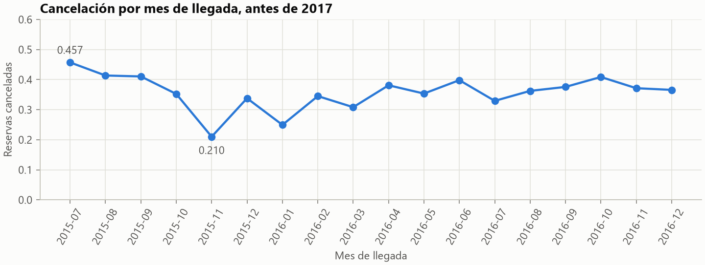

**Muchas filas están repetidas.** El 35.9 % repite exactamente otra, si se comparan las 19 variables de entrada y el objetivo. Con una partición aleatoria caerían a los dos lados, y por eso las métricas también se dan con filas únicas.

**`deposit_type` casi decide por sí sola.** `Non Refund`, con 10 460 reservas, se cancela en el 99.2 % de los casos, frente al 26.8 % de `No Deposit`, y el 93.7 % de sus filas está repetido. Es difícil creer que pagar sin devolución haga cancelar más: apunta a tandas de reservas casi idénticas que se cancelan juntas. Se conserva sin leerla como causa, y el rendimiento se publica por separado. **No consta que se conozca al reservar:** el artículo la calcula con los pagos anteriores a la llegada o a la cancelación.

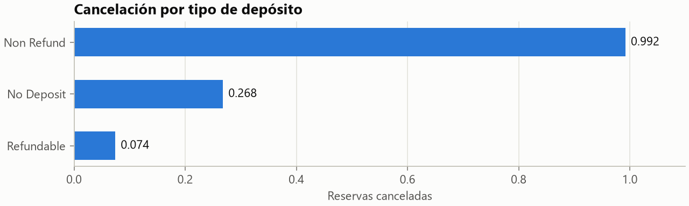

**Algunas variables no se conocen al confirmar.** Ninguna reserva con plaza de parking se cancela, porque la plaza se pide al llegar. `reservation_status` repite el objetivo. Antonio, de Almeida y Nunes (2019), en su artículo de *Data Science Journal*, documentan la fuga de `country`: el sistema rellena Portugal por defecto, y el país real solo se confirma en el check-in. Las 12 variables prohibidas están en [`schema.py`](../src/hotel_cancellation/data/schema.py) con su motivo, y un test falla si alguna llega al modelo.

**`total_of_special_requests` se acumula.** Una reserva cancelada deja de cambiar al cancelarse, de modo que una variable que se acumula debe crecer con la parte de vida transcurrida. En Online TA, las canceladas tienen alguna petición en el 24.0 % de los casos en el primer tramo de vida y en el 58.5 % en el último, mucho más que `booking_changes`, el control positivo. Supera al control en seis de las ocho cohortes, no en todas, y por eso se excluye por cautela y se publica también un escenario con ella.

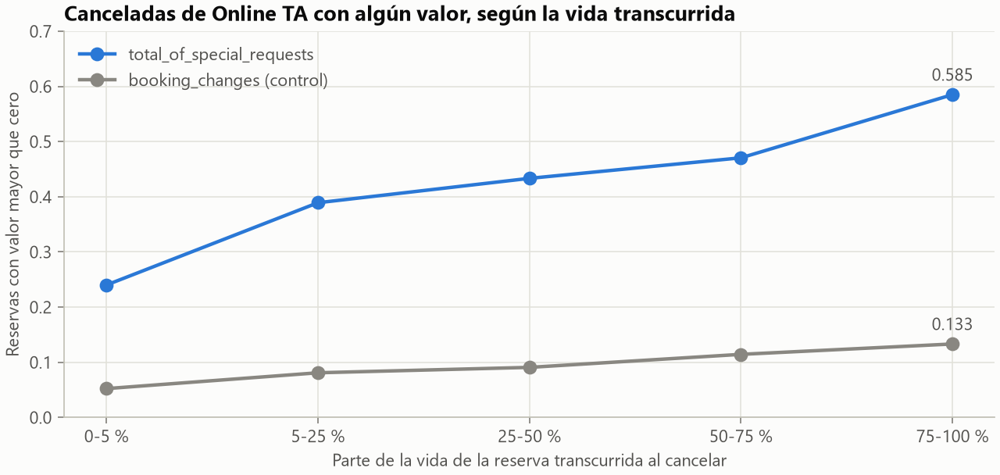

**La antelación importa, pero no en línea recta.** La cancelación va del 10.1 % con menos de una semana al 77.8 % con más de un año. Justifica comparar árboles con un modelo lineal.

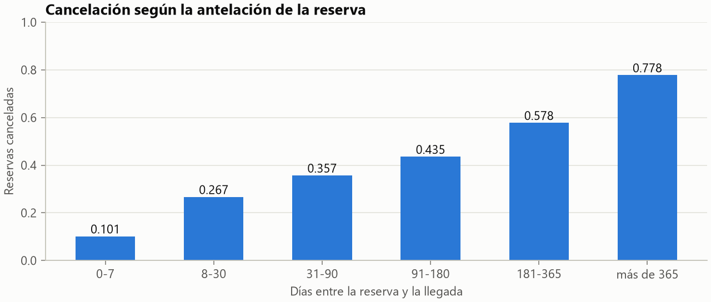

**Nulos, categorías y valores extremos.** `company` está vacía en el 94.4 % de las filas y no aporta, así que queda fuera. `agent` tiene un 13.4 % de nulos y 284 valores, de los que 185 no llegan a 50 filas: se lee como texto y se codifica con `OneHotEncoder(min_frequency=50)`. `adr` tiene una mediana de 89.2 y un máximo de 508.0 tras limpiar.

**Los hoteles y segmentos se comportan distinto.** City Hotel cancela el 41.5 % y Resort Hotel, el 26.6 %. Se usa un solo modelo, porque separarlo por hotel empeora, y las métricas se publican por grupo.

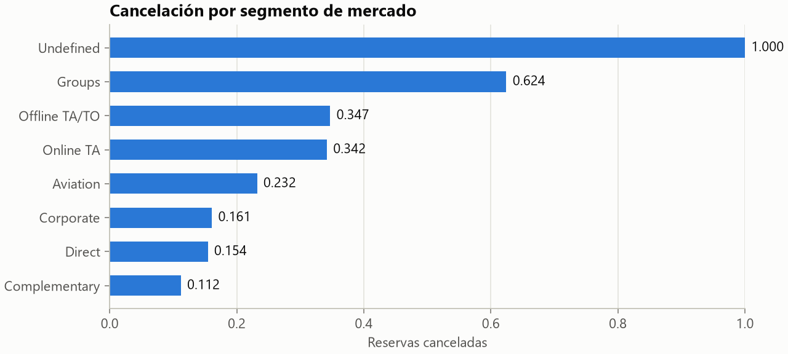

## Diseño del sistema

### Arquitectura

```text
data/raw/*.csv.gz ─ hash y contrato ─ limpieza ─ partición temporal
                                                     │
        ┌─── desarrollo: llegadas anteriores a 2017 ─┴─ test: 2017 ───┐
        ▼                                                             │
experiments/ ─ decisiones de diseño                                   │
hotel-ml tune ─ RandomizedSearchCV con 4 ventanas ─ MLflow            │
hotel-ml train ─ regla 1-SE, calibración y umbral ─ models/champion   │
                                                     │                ▼
                                                     └─ hotel-ml evaluate, una vez
                                                                      │
models/champion + manifest ─ BookingPredictor ─ FastAPI ─ Streamlit   │
outputs/ ─ figuras, informe y notebooks ◄─────────────────────────────┘
```

| Módulo | Responsabilidad |
|---|---|
| `config.py`, `schema.py` | Rutas, fechas y ventanas; fuente única de columnas y valores permitidos |
| `data_loader.py` | Hash, contrato, limpieza, tipos y particiones |
| `features.py`, `models.py` | Preprocesado por familia, catálogo de modelos y adaptador de Keras |
| `model_trainer.py` | Búsqueda, regla 1-SE, calibración y entrenamiento final |
| `evaluator.py` | Métricas, costes, bootstrap por bloques y PSI |
| `pipeline.py`, `cli.py` | Orquestación y comandos `hotel-ml` |
| `champion.py`, `tracking.py` | Paquete del campeón con manifest, y registro en MLflow |
| `explain.py`, `audit.py`, `plots.py` | Importancia, auditoría de inflación y figuras |
| `predictor.py`, `stored_evaluation.py` | Inferencia y lectura de los resultados guardados |
| `api/`, `ui/` | FastAPI y Streamlit |

### Datos y variables

`clean` elimina las reservas imposibles y deja 118 563 filas de 119 390. Entran 19 variables, usadas como si se conocieran al confirmar. `coerce_features` es la única entrada al modelo, y la usan el entrenamiento y la API, de modo que no pueden divergir.

El pipeline es un `ColumnTransformer` con imputación por mediana, escalado solo para regresión logística y MLP, y `OneHotEncoder(handle_unknown="infrequent_if_exist", min_frequency=50)`. Usa solo clases de scikit-learn y XGBoost, así que el artefacto no depende del paquete del proyecto.

### Protocolo

El [protocolo](protocolo.md) se fijó **antes de comparar modelos**:

- **Desarrollo y test:** llegadas anteriores a 2017, y de enero a agosto de 2017 en una sola ejecución.
- **Búsqueda:** `RandomizedSearchCV` con un máximo de 20 iteraciones (6 en la MLP) y cuatro ventanas expansivas, una por trimestre de 2016.
- **Métrica principal: ROC-AUC.** Está en la lista del enunciado, no depende del umbral y no se deja engañar por la proporción de clases. Las secundarias son PR-AUC, Brier, pendiente de calibración, coste, accuracy, precisión, recall y F1 de la clase positiva.
- **Selección:** regla de 1 error estándar sobre las diferencias pareadas por ventana. Entre los empatados gana el más simple: regresión logística, árbol, Random Forest, XGBoost y MLP.
- **Calibración:** sigmoide, isotónica o ninguna, ajustando en 2016T3 y midiendo en 2016T4. Si el Brier mejora menos de 0.001, no se calibra.
- **Umbral:** `t* = C_FP / (C_FP + C_FN)` sobre la probabilidad calibrada, con costes supuestos y declarados.
- **Incertidumbre:** bootstrap por bloques `hotel × fecha de llegada`, con 2000 réplicas y pareado entre modelos, y sensibilidad por semana. Como no cubre la deriva, también se publica la dispersión entre ventanas y el mes a mes.

### Servicio

- **Modelo versionado:** `models/champion/` guarda el modelo y un `manifest.json` con hash, versiones, umbral y métricas. La API comprueba el hash y las versiones al arrancar.
- **API:** `/health`, `/model-info`, `/predict`, `/predict/batch` y `/evaluate`. Valida de forma estricta con Pydantic. `/evaluate` devuelve lo guardado y nunca calcula sobre el test. **No hay `/train`:** entrenar es pesado e inseguro en un servicio, y el enunciado solo lo pone como ejemplo.
- **Interfaz:** Streamlit, con resumen, predicción, evaluación, umbral y coste, interpretabilidad y datos. Consume la API, y avisa si no está disponible.
- **Docker:** `docker compose up` levanta la API, la interfaz y MLflow, publicados solo en `127.0.0.1` y con un usuario sin privilegios. Todo es local, sin hosting remoto.
- **MLflow:** los runs reales están en `mlflow.db`, en local y sin versionar. El servicio de Docker empieza vacío.

Las decisiones difíciles de revertir se justifican en [`docs/adr/`](adr/), y el vocabulario, en el [glosario](glosario.md).

## Resultados y elección final

### Validación en 2016

Media y desviación de las cuatro ventanas expansivas. La pendiente no aparece, porque estas tablas usaron otro recorte, como explica el protocolo.

| Modelo | ROC-AUC | Desviación | Únicas | `No Deposit` | `Non Refund` | PR-AUC | Brier |
|---|---|---|---|---|---|---|---|
| Random Forest | 0.8172 | 0.0231 | 0.7405 | 0.7294 | 0.9945 | 0.7700 | 0.1531 |
| XGBoost | 0.8162 | 0.0282 | 0.7382 | 0.7265 | 0.9857 | 0.7684 | 0.1533 |
| MLP | 0.8053 | 0.0194 | 0.7226 | 0.7098 | 0.9730 | 0.7611 | 0.1578 |
| Árbol de decisión | 0.8007 | 0.0130 | 0.7194 | 0.7024 | 0.7595 | 0.7337 | 0.1590 |
| Regresión logística | 0.7927 | 0.0187 | 0.7137 | 0.6910 | 0.8678 | 0.7465 | 0.1594 |
| Dummy (baseline) | 0.5000 | 0.0000 | 0.5000 | 0.5000 | 0.5000 | 0.3575 | 0.2302 |

### Experimentos de diseño

Cada uno compara una decisión con las mismas ventanas, sobre un XGBoost común de profundidad 6. `Diferencia` es la media pareada de ROC-AUC frente a la primera variante. Se reproducen con `uv run python -m experiments.run_all`.

| Decisión | Variante | ROC-AUC | Diferencia |
|---|---|---:|---:|
| Sin calendario | 19 variables | 0.8141 | |
| | Con año, mes, semana y día | 0.8080 | -0.0061 |
| Sin `company` | Con `company` | 0.8142 | +0.0001 |
| Entrenar con todas las filas | Solo filas únicas | 0.8116 | -0.0025 |
| Un modelo global | Uno por hotel | 0.8061 | -0.0081 |
| Árboles regularizados | Profundidad 16 | 0.7961 | -0.0180 |
| One-hot con `min_frequency` | Ordinal | 0.8096 | -0.0045 |
| | Target encoding de `agent`, pliegues barajados | 0.8115 | -0.0026 |
| Sin balancear | `scale_pos_weight` | 0.8133 | -0.0008 |
| | SMOTE | 0.8128 | -0.0013 |
| | Undersampling | 0.8125 | -0.0016 |
| Sin `total_of_special_requests` | Con ella (XGBoost) | 0.8481 | +0.0340 |

**Embeddings categóricos.** Una MLP con embeddings da 0.8063, frente a 0.8053 con one-hot, una diferencia de +0.0010. No justifica cambiar el diseño: queda como experimento, en [`embeddings.py`](../experiments/embeddings.py).

**Por qué los modelos se ordenan así.** Los árboles combinados recogen interacciones y relaciones no lineales, como la de la antelación, que la regresión logística no ve sin transformar las variables. El árbol único tiene mucha varianza, y Random Forest y XGBoost la reducen de formas distintas y llegan al mismo punto. La MLP no los iguala en estos datos tabulares, con las 6 configuraciones que probó. Sin `Non Refund` y sin filas repetidas, todos bajan: lo que queda es difícil.

### Elección final

| Modelo | ROC-AUC medio | Desviación | Pérdida media frente al mejor | Error estándar pareado | Dentro de la regla |
|---|---:|---:|---:|---:|---|
| Regresión logística | 0.7927 | 0.0187 | 0.0246 | 0.0037 | No |
| Árbol de decisión | 0.8007 | 0.0130 | 0.0165 | 0.0054 | No |
| **Random Forest** | 0.8172 | 0.0231 | 0.0000 | 0.0000 | Sí |
| XGBoost | 0.8162 | 0.0282 | 0.0011 | 0.0035 | Sí |
| MLP | 0.8053 | 0.0194 | 0.0119 | 0.0032 | No |

**Gana Random Forest**, porque está dentro de la regla y es el más simple de los dos empatados. Sus hiperparámetros: 400 árboles, profundidad máxima 14, `min_samples_leaf` 10 y `max_features` 0.2. Se probaron 20 configuraciones.

**Calibración isotónica.** En 2016T4, el Brier es 0.1622 sin calibrar, 0.1602 con sigmoide y 0.1592 con isotónica. La mejora supera el 0.001 que fijaba el protocolo.

**Umbral 0.25**, que corresponde a costes 1:3, supuestos. Con ese umbral, 2016T4 da un coste de 0.4461, y el mejor umbral empírico de ese trimestre, 0.18, da 0.4329. El contraste no se usó para moverlo: el protocolo fija la fórmula.

### Qué se ha ejecutado

- **Registro:** [`outputs/final_evaluation/record.json`](../outputs/final_evaluation/record.json), el 2026-11-02, con el código en `185aa76` y sin `--force`.
- **Modelo:** SHA-256 `41d3a28592ae93367b8a88ca80ed60bb1e5ac2356ec2344d4984c0770f13d7f1`, entrenado con llegadas anteriores a 2016-10-01 y calibrado en 2016T4. Se evalúa sin reentrenar.
- **El test no es estrictamente ciego:** una auditoría previa había visto 2017, y de ella salen `ADR_UPPER_LIMIT`, `min_frequency=50` y las rejillas de búsqueda. Lo detalla el [protocolo](protocolo.md).
- **Modelo congelado:** desde la ejecución no se toca el modelo, las variables ni el umbral.
- **`precision=0` del `Dummy` en validación:** las tablas de validación lo conservan. En las del test, esa celda vale `n/d`.

Toda probabilidad es la calibrada, salvo en SHAP. Los costes son supuestos.

### Modelos y baseline

Umbral de decisión de 0.25, costes 1:3.

| Modelo | ROC-AUC | IC 95 %, hotel y fecha | IC 95 %, semana | PR-AUC | Brier | Pendiente | Accuracy | Precisión | Recall | F1 | Coste 1:3 |
|---|---|---|---|---|---|---|---|---|---|---|---|
| **Random Forest (campeón)** | 0.8175 | [0.8058, 0.8297] | [0.8008, 0.8339] | 0.7608 | 0.1627 | 0.959 | 0.5698 | 0.4729 | 0.9409 | 0.6294 | 0.4761 |
| XGBoost | 0.8164 | [0.8046, 0.8284] | [0.7990, 0.8333] | 0.7564 | 0.1639 | 0.908 | 0.6062 | 0.4962 | 0.9214 | 0.6450 | 0.4549 |
| MLP | 0.8039 | [0.7907, 0.8178] | [0.7846, 0.8228] | 0.7654 | 0.1667 | 1.017 | 0.6809 | 0.5599 | 0.8329 | 0.6696 | 0.4489 |
| Árbol de decisión | 0.8040 | [0.7921, 0.8169] | [0.7851, 0.8227] | 0.7147 | 0.1660 | 1.141 | 0.6240 | 0.5089 | 0.9031 | 0.6510 | 0.4512 |
| Regresión logística | 0.7956 | [0.7809, 0.8096] | [0.7734, 0.8161] | 0.7353 | 0.1700 | 0.912 | 0.6424 | 0.5240 | 0.8618 | 0.6517 | 0.4650 |
| Dummy (baseline) | 0.5000 | [0.5000, 0.5000] | [0.5000, 0.5000] | 0.3883 | 0.2384 | n/d | 0.3883 | 0.3883 | 1.0000 | 0.5594 | 0.6117 |

La pendiente recorta las probabilidades a `[1e-3, 1 - 1e-3]`. Con el campeón vale 0.944 con `1e-6` y 1.000 con `1e-2`. El 0.46% de sus filas tiene probabilidad exactamente 0, y el 10.05%, exactamente 1.

#### Con un umbral fijo de 0.5

Sirve para comparar con otros trabajos. No es el umbral servido.

| Modelo | Accuracy | Precisión | Recall | F1 | VP | FP | FN | VN |
|---|---|---|---|---|---|---|---|---|
| **Random Forest (campeón)** | 0.7484 | 0.6833 | 0.6563 | 0.6695 | 10 324 | 4 785 | 5 406 | 19 994 |
| XGBoost | 0.7455 | 0.6721 | 0.6728 | 0.6724 | 10 583 | 5 163 | 5 147 | 19 616 |
| MLP | 0.7422 | 0.6982 | 0.5919 | 0.6406 | 9 310 | 4 025 | 6 420 | 20 754 |
| Árbol de decisión | 0.7310 | 0.6274 | 0.7571 | 0.6861 | 11 909 | 7 074 | 3 821 | 17 705 |
| Regresión logística | 0.7363 | 0.7473 | 0.4850 | 0.5882 | 7 629 | 2 580 | 8 101 | 22 199 |
| Dummy (baseline) | 0.6117 | n/d | 0.0000 | 0.0000 | 0 | 0 | 15 730 | 24 779 |

#### Costes

| Modelo | 1:2 en su t* | 1:3 en su t* | 1:5 en su t* | 1:2 con umbral 0.25 | 1:5 con umbral 0.25 | VP | FP | FN | VN |
|---|---|---|---|---|---|---|---|---|---|
| **Random Forest (campeón)** | 0.3524 | 0.4761 | 0.5217 | 0.4531 | 0.5219 | 14 801 | 16 498 | 929 | 8 281 |
| XGBoost | 0.3517 | 0.4549 | 0.5159 | 0.4244 | 0.5159 | 14 494 | 14 718 | 1 236 | 10 061 |
| MLP | 0.3660 | 0.4489 | 0.5488 | 0.3840 | 0.5786 | 13 102 | 10 300 | 2 628 | 14 479 |
| Árbol de decisión | 0.3571 | 0.4512 | 0.5163 | 0.4136 | 0.5265 | 14 206 | 13 707 | 1 524 | 11 072 |
| Regresión logística | 0.3851 | 0.4650 | 0.5812 | 0.4113 | 0.5723 | 13 556 | 12 314 | 2 174 | 12 465 |
| Dummy (baseline) | 0.6117 | 0.6117 | 0.6117 | 0.6117 | 0.6117 | 15 730 | 24 779 | 0 | 0 |

#### ROC-AUC por subconjunto

| Modelo | Todas | Únicas | `No Deposit` | `Non Refund` | Diferencia con el campeón, IC 95 % |
|---|---|---|---|---|---|
| **Random Forest (campeón)** | 0.8175 | 0.7608 | 0.7529 | 0.9998 | — |
| XGBoost | 0.8164 | 0.7596 | 0.7516 | 0.9998 | [-0.0033, +0.0008] |
| MLP | 0.8039 | 0.7452 | 0.7349 | 0.9925 | [-0.0179, -0.0101] |
| Árbol de decisión | 0.8040 | 0.7399 | 0.7356 | 0.4676 | [-0.0170, -0.0099] |
| Regresión logística | 0.7956 | 0.7405 | 0.7240 | 0.9055 | [-0.0276, -0.0167] |
| Dummy (baseline) | 0.5000 | 0.5000 | 0.5000 | 0.5000 | [-0.3297, -0.3058] |

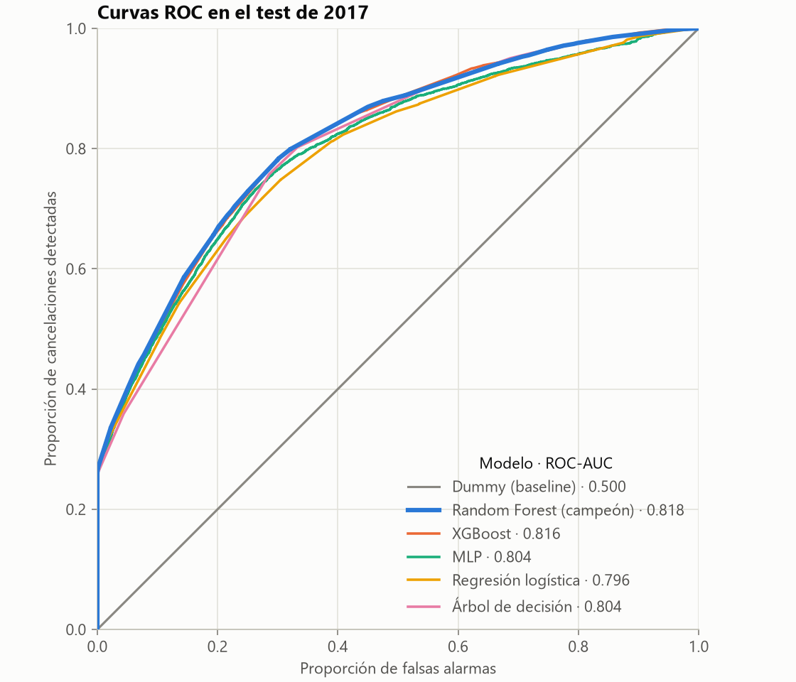

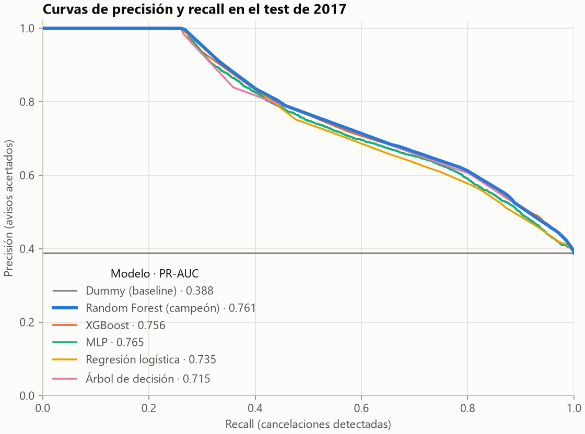

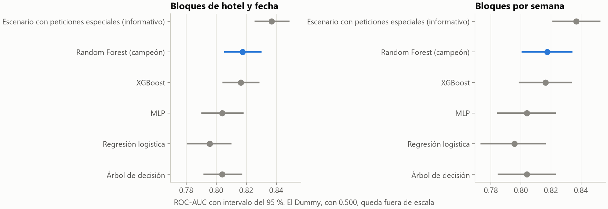

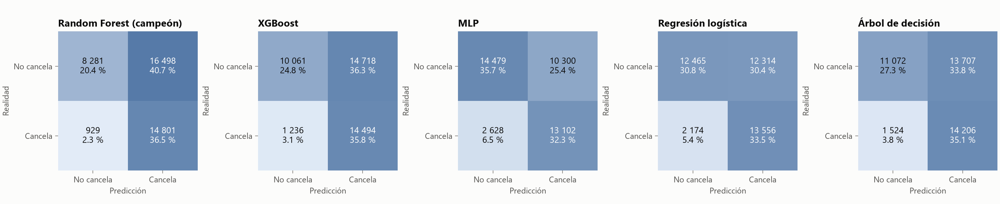

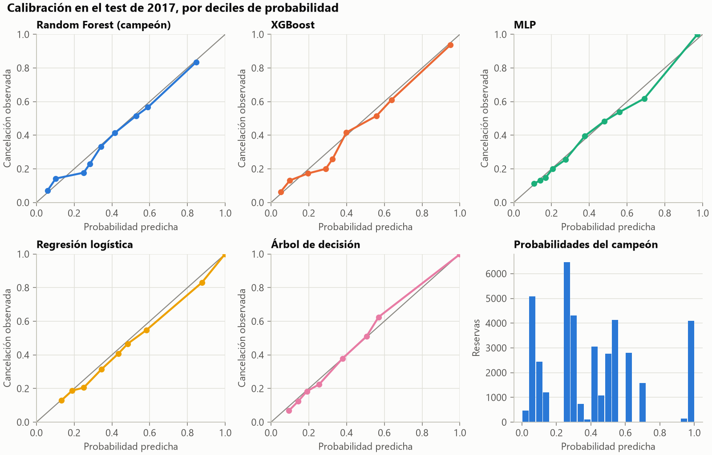

### Segmentos del campeón

Umbral de decisión de 0.25. El resto de segmentos está en [`segments.csv`](../outputs/final_evaluation/segments.csv).

| Filas analizadas | Filas | Prevalencia | ROC-AUC | PR-AUC | Brier | Pendiente | Precisión | Recall | F1 | Coste 1:3 |
|---|---|---|---|---|---|---|---|---|---|---|
| Todas | 40 509 | 0.3883 | 0.8175 | 0.7608 | 0.1627 | 0.959 | 0.4729 | 0.9409 | 0.6294 | 0.4761 |
| Únicas | 29 667 | 0.3300 | 0.7608 | 0.5820 | 0.1807 | 0.937 | 0.4082 | 0.9253 | 0.5665 | 0.5166 |
| `No Deposit` | 36 356 | 0.3187 | 0.7529 | 0.5456 | 0.1810 | 0.949 | 0.3926 | 0.9199 | 0.5503 | 0.5301 |
| `Non Refund` | 4 126 | 0.9981 | 0.9998 | 1.0000 | 0.0010 | 3.996 | 0.9981 | 1.0000 | 0.9990 | 0.0019 |
| `City Hotel` | 27 396 | 0.4262 | 0.8201 | 0.7917 | 0.1644 | 1.051 | 0.4851 | 0.9670 | 0.6461 | 0.4797 |
| `Resort Hotel` | 13 113 | 0.3091 | 0.8020 | 0.6440 | 0.1592 | 0.903 | 0.4375 | 0.8658 | 0.5813 | 0.4685 |

La pendiente de `Non Refund` no se debe leer: el 99.8% de esas filas se cancela.

### Mes a mes

| Mes | Filas | Prevalencia | ROC-AUC | Brier |
|---|---|---|---|---|
| 2017-01 | 3 650 | 0.3422 | 0.8742 | 0.1299 |
| 2017-02 | 4 142 | 0.3271 | 0.8165 | 0.1520 |
| 2017-03 | 4 933 | 0.3387 | 0.8340 | 0.1461 |
| 2017-04 | 5 648 | 0.4352 | 0.8358 | 0.1588 |
| 2017-05 | 6 291 | 0.4389 | 0.8312 | 0.1597 |
| 2017-06 | 5 632 | 0.4329 | 0.8075 | 0.1693 |
| 2017-07 | 5 298 | 0.3745 | 0.7568 | 0.1890 |
| 2017-08 | 4 915 | 0.3691 | 0.7697 | 0.1854 |

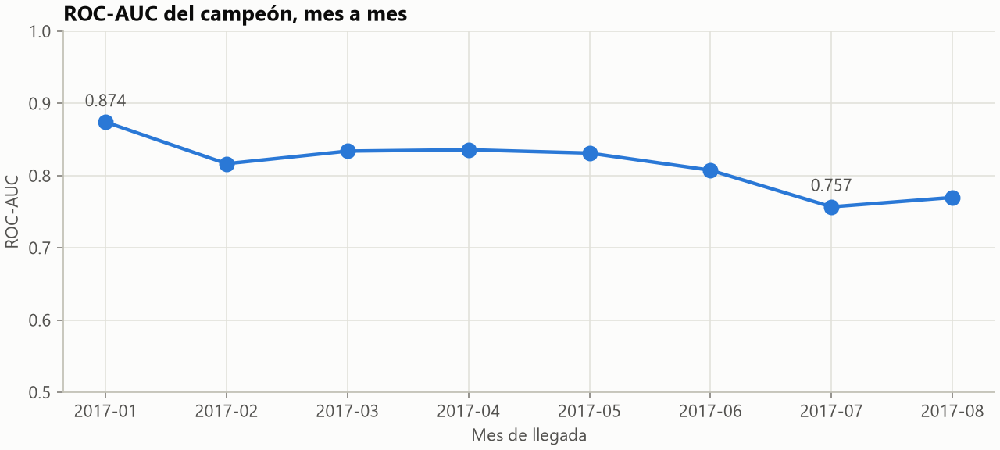

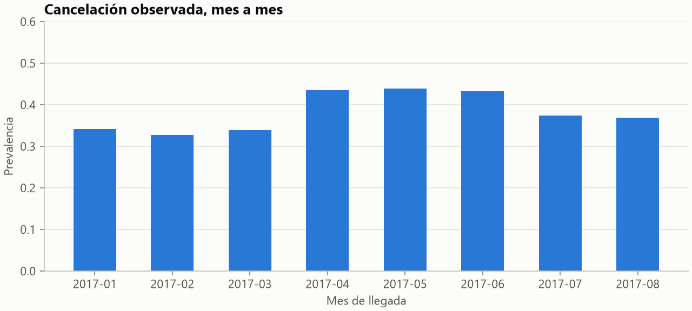

### Deriva

PSI de cada variable frente a las llegadas anteriores a 2016-10-01, con las que aprendió el modelo base.

| Variable | PSI |
|---|---|
| `agent` | 0.7591 |
| `previous_cancellations` | 0.2379 |
| `adr` | 0.1706 |
| `customer_type` | 0.1321 |
| `days_in_waiting_list` | 0.1233 |
| `market_segment` | 0.1182 |
| `meal` | 0.0677 |
| `reserved_room_type` | 0.0343 |
| `lead_time` | 0.0285 |
| `stays_in_week_nights` | 0.0159 |
| `deposit_type` | 0.0138 |
| `children` | 0.0074 |
| `adults` | 0.0072 |
| `stays_in_weekend_nights` | 0.0052 |
| `previous_bookings_not_canceled` | 0.0040 |
| `distribution_channel` | 0.0031 |
| `hotel` | 0.0019 |
| `is_repeated_guest` | 0.0013 |
| `babies` | 0.0009 |

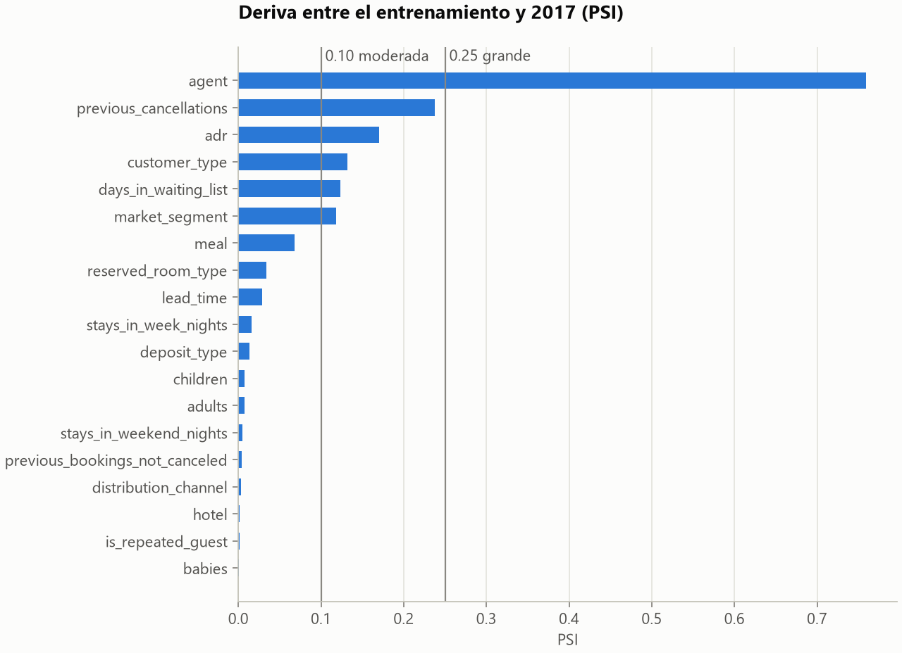

### Escenario con `total_of_special_requests`

**Es solo informativo y no puede cambiar el campeón.** Es un Random Forest con los mismos hiperparámetros, ventanas y calibración, y con esa variable añadida. El diagnóstico de la [data card](data_card.md) indica que se acumula durante la vida de la reserva, aunque es observacional, y por eso se publican los dos escenarios.

ROC-AUC de 0.8369, con un intervalo de [0.8260, 0.8484]. Frente al campeón, la diferencia pareada va de [+0.0155, +0.0233] con bloques de hotel y fecha, y de [+0.0148, +0.0239] por semana.

| Filas analizadas | ROC-AUC oficial | ROC-AUC escenario | PR-AUC oficial | PR-AUC escenario | Brier oficial | Brier escenario | Pendiente escenario | Recall escenario | F1 escenario | Coste 1:3 escenario |
|---|---|---|---|---|---|---|---|---|---|---|
| Todas | 0.8175 | 0.8369 | 0.7608 | 0.7835 | 0.1627 | 0.1577 | 0.776 | 0.8975 | 0.6775 | 0.4114 |
| Únicas | 0.7608 | 0.7782 | 0.5820 | 0.6122 | 0.1807 | 0.1785 | 0.724 | 0.8705 | 0.6037 | 0.4626 |
| `No Deposit` | 0.7529 | 0.7792 | 0.5456 | 0.5856 | 0.1810 | 0.1754 | 0.757 | 0.8609 | 0.5977 | 0.4580 |
| `Non Refund` | 0.9998 | 0.9997 | 1.0000 | 1.0000 | 0.0010 | 0.0011 | 3.764 | 1.0000 | 0.9990 | 0.0019 |

### Valor de negocio

**Los costes son supuestos, no datos del hotel.** Cada fila indica qué haría el campeón si un falso positivo costara lo que dice el escenario. El coste sin modelo es el de la mejor política trivial: avisar de todas las reservas o de ninguna.

| Costes FP:FN (supuestos) | Umbral | Recall | Precisión | Cancelaciones detectadas | Falsas alarmas | Cancelaciones perdidas | % de no canceladas avisadas | % de reservas avisadas | Coste por reserva | Coste sin modelo | Ahorro por reserva |
|---|---|---|---|---|---|---|---|---|---|---|---|
| 1:2 | 0.333 | 0.7991 | 0.6124 | 12 570 | 7 956 | 3 160 | 32.1 % | 50.7 % | 0.3524 | 0.6117 | 0.2593 |
| 1:3 | 0.250 | 0.9409 | 0.4729 | 14 801 | 16 498 | 929 | 66.6 % | 77.3 % | 0.4761 | 0.6117 | 0.1356 |
| 1:5 | 0.167 | 0.9411 | 0.4729 | 14 803 | 16 500 | 927 | 66.6 % | 77.3 % | 0.5217 | 0.6117 | 0.0900 |

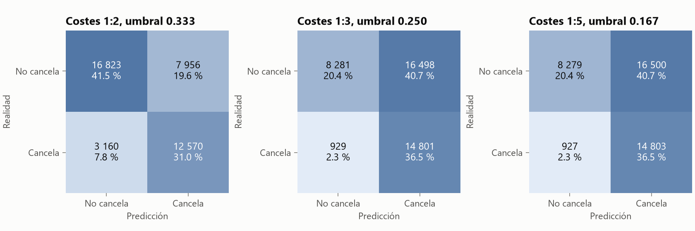

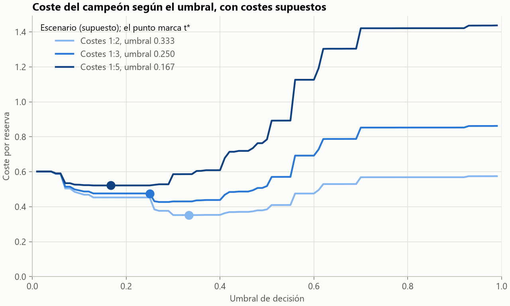

### Auditoría de la inflación

Se reproduce con `hotel-ml audit`, y los tres primeros escalones se entrenan de nuevo. La cuarta fila copia la cifra publicada.

| Escalón | Modelo | Filas de train | Filas de test | Test ya en train | ROC-AUC | PR-AUC | Brier |
|---|---|---|---|---|---|---|---|
| Partición aleatoria, variables de partida | XGBoost de partida | 94 850 | 23 713 | 32.0 % | 0.9524 | 0.9339 | 0.0838 |
| Partición temporal, variables de partida | XGBoost de partida | 78 054 | 40 509 | 0.0 % | 0.8683 | 0.8270 | 0.1630 |
| Partición temporal, sin country ni booking_changes | XGBoost de partida | 78 054 | 40 509 | 0.0 % | 0.8184 | 0.7802 | 0.1775 |
| Modelo oficial: 19 variables, sin calendario ni variables acumuladas | Random Forest | 78 054 | 40 509 | n/d | 0.8175 | 0.7608 | 0.1627 |

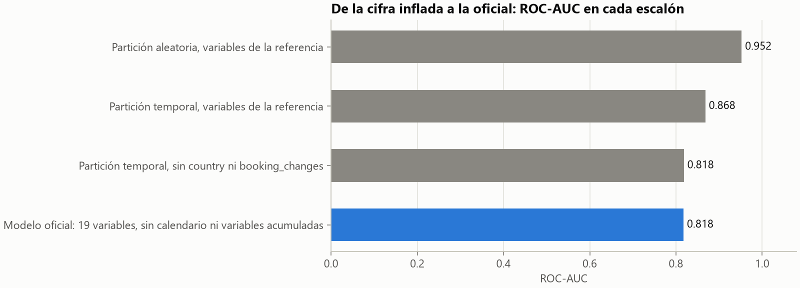

- **De 0.952 a 0.868:** es el efecto de evaluar en el futuro. En la partición aleatoria, el 32.0 % de las filas de test ya estaba en train. El 0.0 % de la partición temporal es trivial, porque la comparación incluye la fecha de llegada; con solo las 19 variables, en las ventanas de 2016 va del 0.7 % al 2.5 %. La conclusión se mantiene.
- **De 0.868 a 0.818:** es lo que aportaban `country` y `booking_changes`.
- **El tercer escalón y el oficial casi coinciden, y es casualidad.** El tercero conserva `total_of_special_requests`, el calendario y árboles de profundidad 16, y esos efectos se compensan.

### Interpretación

**Sirve para interpretar, no decide nada y no indica causas.** Los valores se agregan por variable original.

- `feature_importances_`: sale del modelo base, y favorece a las variables con muchas categorías.
- Permutación: caída del ROC-AUC del campeón al barajar cada variable en 2017, con 10 repeticiones.
- SHAP: 2000 filas de 2017, en la probabilidad sin calibrar del modelo base.

| Variable | `feature_importances_` | Permutación (caída de ROC-AUC) | ± desviación | \|SHAP\| medio |
|---|---|---|---|---|
| `deposit_type` | 0.4352 | 0.1502 | 0.0018 | 0.1281 |
| `lead_time` | 0.0908 | 0.0583 | 0.0015 | 0.0475 |
| `agent` | 0.0821 | 0.0437 | 0.0008 | 0.0431 |
| `customer_type` | 0.0454 | 0.0332 | 0.0007 | 0.0326 |
| `market_segment` | 0.0568 | 0.0210 | 0.0008 | 0.0335 |
| `previous_bookings_not_canceled` | 0.0061 | 0.0053 | 0.0001 | 0.0032 |
| `adr` | 0.0318 | 0.0050 | 0.0005 | 0.0109 |
| `hotel` | 0.0098 | 0.0048 | 0.0006 | 0.0068 |
| `distribution_channel` | 0.0143 | 0.0041 | 0.0003 | 0.0086 |
| `previous_cancellations` | 0.1787 | 0.0030 | 0.0004 | 0.0340 |
| `stays_in_week_nights` | 0.0115 | 0.0026 | 0.0002 | 0.0046 |
| `adults` | 0.0058 | 0.0021 | 0.0003 | 0.0019 |
| `meal` | 0.0087 | 0.0020 | 0.0001 | 0.0046 |
| `stays_in_weekend_nights` | 0.0066 | 0.0009 | 0.0002 | 0.0022 |
| `is_repeated_guest` | 0.0026 | 0.0008 | 0.0001 | 0.0005 |
| `reserved_room_type` | 0.0046 | 0.0007 | 0.0002 | 0.0020 |
| `children` | 0.0013 | 0.0006 | 0.0001 | 0.0014 |
| `babies` | 0.0001 | 0.0001 | 0.0000 | 0.0000 |
| `days_in_waiting_list` | 0.0076 | -0.0000 | 0.0000 | 0.0014 |

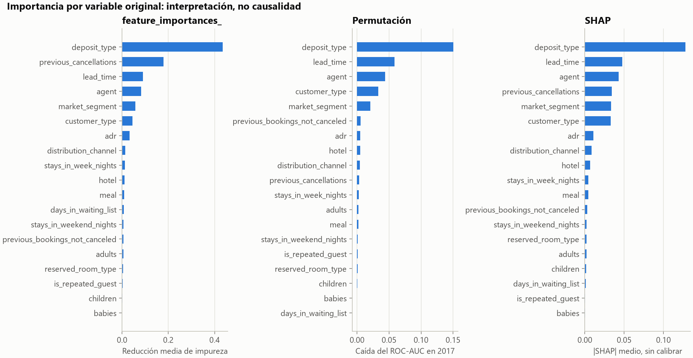

`deposit_type` domina en los tres métodos. No debe leerse como causa: `Non Refund` concentra grupos de reservas casi idénticas que se cancelan juntas, y no consta que se conozca al reservar.

## Reflexión crítica

### Lo que el test señala y no se corrige

Se declara tal cual. El modelo sigue congelado.

1. **El campeón no es el más barato con su propio umbral.** Con costes 1:3 cuesta 0.4761 por reserva, el peor de los cinco modelos: MLP 0.4489, árbol 0.4512, XGBoost 0.4549 y regresión logística 0.4650. La selección se hizo por ROC-AUC, como manda el protocolo.
2. **El umbral 0.25 cae justo antes de un gran escalón de la isotónica.** Con umbrales entre 0.27 y 0.30, el coste 1:3 baja a unos 0.43. Por el mismo motivo, los escenarios 1:3 y 1:5 toman casi las mismas decisiones: solo 4 filas tienen una probabilidad entre 0.167 y 0.25.
3. **El umbral servido da muchas falsas alarmas.** Avisa del 77.3% de las reservas, con 16 498 falsas alarmas. Parte de la explicación es suponer que perder una cancelación cuesta tres veces más, pero no toda: con esos mismos costes, en 2016 avisaba del 46 % al 63 %, y ese rango no anticipaba el 77.3 %.
4. **XGBoost no se distingue del campeón.** La diferencia pareada va de [-0.0033, +0.0008], y la regla de selección ya los había dejado empatados en validación.
5. **El rendimiento cae al final del periodo.** El ROC-AUC baja de 0.8742 en enero a 0.7568 en julio. El intervalo del bootstrap no cubre esta deriva.
6. **`agent` deriva mucho** (PSI 0.7591) y `previous_cancellations` algo menos (0.2379). Es una limitación de usar identificadores de agente en un modelo que no se reentrena.
7. **La mejor PR-AUC es de la MLP:** 0.7654, frente a 0.7608 del campeón, aunque su ROC-AUC queda por debajo. Elegir otra métrica principal habría cambiado el orden.

### Por qué no se corrige

Mover el umbral o cambiar de modelo tras ver estas cifras convertiría el test en validación, y dejaría el proyecto sin una estimación honesta. El protocolo existe para eso. Son propuestas para una versión posterior, que tendría que medirse con datos nuevos.

### Limitaciones

- Dos hoteles y dos años de datos: no se puede generalizar a otros hoteles.
- **Ninguna variable se puede comprobar al confirmar:** el artículo referencia los valores al día anterior a la llegada. Las definidas al crear o confirmar dan 0.6866 en 2016, y el rendimiento real está entre esa cifra y la publicada.
- Los costes son supuestos.
- El test no es estrictamente ciego, como se declara arriba.
- Una sola calibración, ajustada en 2016T4: si la cancelación se mueve, la probabilidad deja de estar bien calibrada, y la isotónica concentra filas en escalones.
- La selección usa el ROC-AUC, que ordena bien pero no mide el coste de decidir. Ese es el origen de que el campeón no sea el más barato.

### Propuestas de mejora

- **Historial de la reserva:** con los valores en el momento de confirmar se podría resolver lo que aquí queda en duda, como `total_of_special_requests` o `adr`.
- **Costes reales:** con los costes del hotel, el umbral sería una decisión de negocio, y no un supuesto.
- **Selección por coste:** añadir el coste en validación como criterio, y elegir el umbral con datos en lugar de solo con la fórmula.
- **Reentrenamiento:** el rendimiento cae en verano de 2017 y `agent` deriva mucho. En 2016, reentrenar cada mes en lugar de cada trimestre da +0.0083 [+0.0011, +0.0155], y no reentrenar en todo el año pierde 0.0249. Es la mejora real más probable, y debería medirse con datos nuevos antes de adoptarla.
- **Más hoteles:** con dos, nada de esto se puede generalizar.

Una propuesta inicial se descartó al medirla: sustituir los identificadores de agente por su tasa histórica, calculada solo con el pasado, da -0.0045 [-0.0121, +0.0031].

### Segunda revisión

Tras la entrega se hizo una [revisión independiente](revision_datos_y_validacion.md) de los datos y de la validación, con su [protocolo](revision_protocolo.md) fijado antes de experimentar. **El modelo, el umbral y las cifras publicadas no cambian.** La línea base se reprodujo exactamente.

**Lo que aguanta:** no hay fuga en el preprocesado, la fuga neta por tandas entre ventanas es de 0.0036, y la búsqueda anidada apenas baja las cifras. Ninguno de los 50 cambios probados en datos, variables y modelos cumple la regla de aceptación. El techo con estas variables ronda 0.83, y 0.75 con `No Deposit`.

**Lo que corrige:**

- **El momento de predicción es un supuesto.** Se asumió sin contrastarlo con el artículo del dataset.
- **La cifra global mezcla reservas que el modelo no vería al confirmar.** Entre el 31 % y el 69 % de las filas de cada ventana de 2016 se confirmaron antes del corte de entrenamiento.
- **El intervalo se queda algo estrecho,** porque las reservas se cancelan por tandas.

**Análisis posterior sobre 2017.** Se leyeron las predicciones guardadas, sin puntuar ninguna fila, sin cambiar nada y sin que saliera ninguna decisión. No es una evaluación nueva.

| Medida en 2017 | ROC-AUC |
|---|---:|
| Publicada, con IC por hotel y fecha | 0.8175 [0.8058, 0.8297] |
| Publicada, por subconjunto | Únicas 0.7608, `No Deposit` 0.7529, `Non Refund` 0.9998 |
| Con IC por hotel, día de estado y agente | 0.8175 [0.8010, 0.8336] |
| Confirmadas desde 2017-01-01 | 0.7917 |
| Las mismas, con `No Deposit` | 0.7540 |
| Canceladas 31 días o más antes de llegar, frente a las estancias | 0.8739 |
| Canceladas de 8 a 30 días antes, frente a las estancias | 0.7623 |
| Canceladas hasta 7 días antes, frente a las estancias | 0.5541 |
| `No-Show`, frente a las estancias | 0.5170 |

**El modelo apenas ve las cancelaciones que justifican el proyecto:** las que dejan la habitación vacía a última hora.

### Qué aprendí

- **Una cifra alta es una pregunta, no una respuesta.** El 0.9524 inicial parecía un buen resultado, y era sobre todo fuga y filas repetidas.
- **Hay que leer la fuente de los datos antes de afirmar qué se conoce y cuándo.** Corregí 0.95 con cuidado, y aun así di por hecho el momento de captura de las variables, que el artículo del dataset dejaba claro.
- **La parte difícil del aprendizaje automático suele estar antes del modelo.** Las mayores diferencias salen de cómo se evalúa y de qué variables se conocen en el momento de predecir, no de elegir entre Random Forest y XGBoost.
- **Fijar el protocolo antes de mirar cuesta, pero compensa.** Obliga a publicar lo que el test señala, también cuando deja mal al modelo elegido.

## Bibliografía

- Antonio, N., de Almeida, A. y Nunes, L. (2019). Hotel booking demand datasets. *Data in Brief*, 22, 41-49. <https://doi.org/10.1016/j.dib.2018.11.126>. Licencia CC BY 4.0.
- Antonio, N., de Almeida, A. y Nunes, L. (2019). An Automated Machine Learning Based Decision Support System to Predict Hotel Booking Cancellations. *Data Science Journal*, 18, 32. <https://doi.org/10.5334/dsj-2019-032>.
